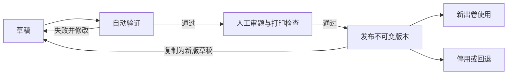

# 四年级数学 · 知识点与模板维护设计

> 从头脑风暴工作空间迁入的产品/内容背景资料。当前实现以工程内详细设计为准；文中历史阶段状态不代表开发进度。

日期：2026-10-26。状态：内容调研与维护设计参考，不是已核定的教材目录。一期字段、API和状态机以 `../design/v1/00-设计入口.md` 及其关联文档为准。

## 1. 用户已明确的方向

- 产品名为“纸上练”，内容只采用当前整理的河南省郑州市小学四年级数学上下册候选目录。
- 一期提供基础、提高、挑战三档难度；每档具体内容尚待样题确认。
- 各题型分别选 3/6/8/10/12 等数量档，总题量自动汇总；不再按整卷固定题数分配比例。
- 表、数据对象、后台按完整功能考虑；一期只实现满足一期需要的功能。允许适当多设计表，减少后续核心结构返工。
- 最新确认：教材出版社与修订版次暂缓；沿用现有候选清单，模板逐个整理、分批开放，不要求一期全量出题。其余按一期方案建议，具体决定见 `纸上练 · 一期方案.md` 第 10 节。

## 2. 教材核验结果与使用边界

### 2.1 已查到的事实

郑州教育信息网 2026-08-25 的报道明确：当地开展人教版小学数学新教材培训，涉及 **2026 年秋季投入使用的四、五、六年级上册**。[S1]

这支持先调查人教版，但不能据此断言郑州每所学校全部采用同一版本，也不能替代孩子所在学校教材确认。

闪电新闻官方账号 2026-09-09 发布了四上新版变更说明与目录图片，涵盖万以上数、角、多位数乘法、数量关系模型、四边形和统计等；文章自身也说明最终以正式教材为准。[S2]

人教社官方网站提供了依据 2011 年课标修订的四下教材内容介绍，可用于确认旧版下册知识领域，不能据此称为 2027 春新版目录。[S3]

### 2.2 当前不能确认的部分

- 用户学校实际使用的出版社、版权页版次和学年。
- 与 2026 秋上册配套的新版下册完整目录：本轮尚未找到并成功核验官方完整内容；这不等于判定教材尚未出版。
- 国家智慧教育平台教材入口已找到，但本轮工具未成功读取正文；不将它写成已经逐页核对的来源。

因此，下面分成“新版上册候选映射”和“旧版下册参考知识池”。**两者不是一套已核定的上下册。** 待教材确认后，调整章节映射即可，知识点与模板不必重建。

建议教材标识记录：出版社、教材系列、学制、课标版本、修订版次、年级、册别、ISBN（取得后记录）、适用学年、来源、核验状态。印刷年份与内容修订版次分开记录。

## 3. 上册：2026 秋人教新版候选知识点

以下目录领域来自 [S2]；细化的知识点、训练目标与生成方式是本项目的设计拆分，不是逐条照抄教材，也不代表已经完成教学审校。正式课时名称、页码、个别训练边界待实物/官方教材复核。

编号为草案知识点编码，刻意不含郑州、年级、学期和单元序号，便于换教材复用。

| 教材领域（候选） | 建议知识点编码与内容 | 题目生成与维护重点 |
| --- | --- | --- |
| 万以上整数 | N001 数位与计数单位；N002 大数读写；N003 大小比较；N004 以万/亿为单位改写；N005 指定位数近似值 | 区分准确改写与近似改写；覆盖连续零、跨级进位、临界舍入 |
| 大数量感实践 | N006 大数量的估计与解释 | 情境与数量级合理；不只靠数字变大制造挑战 |
| 角的测量 | G001 角的分类；G002 量角器读数；G003 按度数画角；G004 已知角度关系求未知角 | 读图题需要明确刻度；画图题给作图要求与参考图 |
| 多位整数乘法 | O001 整数乘法口算；O002 多位数乘两位数笔算；O003 含零因数的笔算；O004 乘积变化规律；O005 乘法估算与判断 | 训练目标分别标注，不把口算、竖式和应用题当成同一模板 |
| 数量关系模型 | M001 整体与部分；M002 相差关系；M003 单价、数量与总价；M004 速度、时间与路程；M005 多步数量关系问题 | 控制单位和已学运算；应用题语义必须与答案一致 |
| 平行、垂直与四边形 | G005 平行与垂直判断；G006 按要求作平行/垂直线；G007 平行四边形特征；G008 梯形特征与辨别 | 生成结构化几何图；底和高是否属于当前册不默认沿用旧版 |
| 条形统计 | S001 单组数据读取；S002 多组数据比较；S003 补全统计图；S004 基于图表的数量推理 | 数据、刻度、图例与答案来自同一份结构化数据 |
| 路线综合实践 | P001 方向、距离与路线描述 | 作为候选实践项；所需先修知识、具体教材归属待核 |
| 鸡兔类数量推理 | M006 列表尝试；M007 假设调整 | 默认采用小学可理解的列表/假设解释，不输出二元方程组解析 |
| 复习整理 | 不另建“总复习知识点” | 由已确认知识点组合成训练包，避免重复计数 |

上册草案共列出 31 个独立编码；这是本项目粒度选择，不是教材宣称的知识点总数。

## 4. 下册：旧版参考知识池，新版映射待核

领域依据为人教社四下教材介绍 [S3]；以下细化同样属于项目设计。此表可以提前用于建模与内容准备，但**不能标注为“2027 春四下同步练习已齐备”**。

| 旧版下册参考领域 | 建议知识点编码与内容 | 与新版的关系/实现提示 |
| --- | --- | --- |
| 四则运算关系与顺序 | O006 运算各部分关系；O007 混合运算顺序；O008 括号与计算步骤；M008 方案比较与费用问题 | 方案比较需定义可选方案与“最优”条件，不能只随机拼题 |
| 观察组合物体 | G009 从不同方向辨认投影；G010 组合物体与视图对应 | 使用立方体位置数据生成视图；不能凭图片想象计算答案 |
| 运算定律与简算 | O009 加法交换/结合；O010 乘法交换/结合；O011 乘法分配；O012 连减等简便运算 | 每条定律可再细分为独立训练目标；简算步骤需要专用解释 |
| 小数概念 | N007 小数数位与读写；N008 小数性质；N009 小数大小比较；N010 小数点移动；N011 小数与计量单位；N012 小数近似值 | 区分数值等价与按要求保留位数；保留原始数值精度 |
| 三角形 | G011 边长条件；G012 按角/边分类；G013 内角关系；G014 底与高的识别 | 生成图必须符合边角约束；具体课时边界再核教材 |
| 小数加减 | O013 小数加法；O014 小数减法；O015 小数加减混合；O016 小数简算 | 用精确十进制/整数缩放计算；题目要求与显示末尾零规则分开 |
| 图形变换 | G015 轴对称辨别与补全；G016 方格图平移 | 保留网格单位；反射/平移后坐标用于校验 |
| 平均数与统计 | S005 平均数含义；S006 平均数计算与反求；复用 S002/S003 多组统计 | 复式统计在新版上册已有候选映射，不创建第二份知识点 |
| 数量推理 | 复用 M006/M007 | 鸡兔类内容也出现在新版上册报道中，必须按版本区分归属 |
| 综合实践与复习 | 可建营养搭配等训练包，具体规则待审 | 作为组合活动，不把项目名称当成原子知识点 |

下册参考池新增 28 个编码；加上上册 31 个，共 59 个候选原子/小粒度知识点，另有复用项。后续审题可以进一步拆分或合并，不以此数量承诺开发工作量。

另设 O017“除数为两位数的整数除法”为 **新版下册待核映射**：新版上册变更报道提到其移出上册 [S2]，本轮不据此确定下册单元编号、顺序或具体内容边界。加入后候选池为 60 个编码。

## 5. 知识点如何组织

建议分四层：

- **章节**回答“课本在哪里教”。新旧版教材可以有不同目录。
- **知识点**回答“孩子学什么”。例如多位数乘两位数，不随单元位置改变身份。
- **训练目标**回答“具体练什么”。例如正确进位、处理中间零、理解部分积。
- **模板**回答“怎样反复生成此类题”。一个知识点对应多个模板，综合模板可关联多个知识点。

“挑战”是相对于已学内容的要求，不等于超纲。模板标记主考查点、辅助点与先修点；组卷时不得把孩子尚未学习的辅助点偷偷引入。

地区只是教材使用背景，不写入知识点编码。地区/学校与教材的对应关系必须带学年、来源和核验状态；没有证据时用户自主选教材，不能自动断定。

### 知识点后台建议字段

稳定编码、名称、别名、内容领域、定义、训练边界、常见错误、先修要求、来源、负责人、修订说明、状态。教材映射另存册次/章节/顺序/页码/核验状态。

一项知识点可有多个训练目标；“题干里出现乘法”不等于主考查乘法。主次关系用于筛选、难度校验与后续错题统计。

### 知识点维护动作

1. 新建草稿或批量导入草稿；导入先展示差异，不直接覆盖已发布内容。
2. 选择/建立教材版本和章节，将知识点映射进去，附来源与核验标记。
3. 定义基础、提高、挑战的训练目标；并非给知识点固定贴一个难度。
4. 关联模板，查看知识点×难度×题型覆盖矩阵；显示未实现、待验证、可发布等状态。
5. 审核知识范围与样题后发布。目录可发布但尚不能出题的项，用户端明确显示“暂未开放”或按产品决定隐藏。
6. 改名不换稳定 ID；内容含义改变则建立修订版。合并/拆分保留关联与历史，不能删除旧试卷所引用内容。

## 6. 模板维护：配置与算法分层

建议不用“每个知识点写一个 Python 脚本”的方式堆积内容。先设计少量可复用的生成器类型：整数运算、数位读写、数量关系应用题、精确小数、几何图形、统计图、方格变换等，再为训练目标配置模板。

| 维护内容 | 建议维护位置 | 是否需要发布后端 |
| --- | --- | --- |
| 名称、知识点关联、难度、题型、题干占位符、受控参数范围、解答留白 | 后台模板草稿 | 已有算法支持时不需要，但必须验证发布 |
| 模板排序、启停、当前可用版本 | 后台发布操作 | 不需要，保留操作记录 |
| 新的生成策略、计算方法、校验器、复杂图形构造 | 代码仓库 | 需要代码测试和部署 |
| 新算法的可配置字段与范围 | 随算法注册的参数结构 | 先更新算法，再允许后台使用新参数 |

后台不接受任意 Python、SQL 或可执行表达式；选择已注册生成器和白名单规则。模板插值只读取规定字段，避免把管理后台做成远程代码执行器。

AI 可以帮助起草知识点拆分、情境文案和模板代码，但不作为无需校验的上线通道；不在用户每次出卷时临时自由编题作为默认方案。

### 每个模板版本应包含

- 稳定 template_id、version、标题、主/辅助训练目标、题型与作答形式。
- generator_key、generator_version、renderer_version、schema_version 与参数结构。
- 难度档、允许参数、约束规则、去重规则、先修知识和适用训练范围。
- 题干结构、选项规则、答案结构、解析步骤配置、图形定义、预计留白/高度。
- 验证报告、人工检查记录、创建人、发布时间、变更原因、配置内容 hash。

题型（选择/填空/解答）与呈现形式（口算/竖式/应用/读图/作图）分开。一期若仍只开放三种题型，可把作图归为解答，但必须使用正确的作答区和参考答案形式。

## 7. 一个完整模板例子

示例为自主设计，用于说明维护方式，不是教材例题复制，也不是用户已确认的正式内容。

### 7.1 多位数乘法练习族

知识点 O002，训练目标为“按位计算并正确合并部分积”。

| 难度 | 示例 | 模板/规则设计 |
| --- | --- | --- |
| 基础 | 列竖式计算 123×12，答案 1476 | 数位范围较小，控制进位次数，给充足竖式区域 |
| 提高 | 列竖式计算 308×26，答案 8008 | 加入中间零、进位和部分积对齐，专门校验步骤 |
| 挑战 | 给出已挖空的乘法竖式，按部分积信息补数 | 使用独立“竖式缺数”模板；先构造正确完整竖式，再挖空并验证解唯一 |

挑战模板不能仅把数值范围放大。若缺数题有多个正确解，要么明确要求找一种解，要么调整挖空位置，不能仍标“唯一答案”。

### 7.2 应用题模板的参数与解析

题干示例：“每盒装 18 支笔，原有 24 盒，卖出 17 盒，还剩多少支笔？”

- 原始参数：每盒数量、原有盒数、售出盒数；约束为正整数，售出盒数小于原有盒数。
- 主目标：M005 多步数量关系；辅助目标：整数减法、乘法。不是仅因含乘法就全部归为 O002。
- 计算：剩余盒数=24−17=7；剩余支数=7×18=126。
- 答案对象：数值 126，单位“支”，参考解释为两步算术，不使用未知数方程。
- 后台允许改数量范围、物品词库、是否提供示意图；不允许编辑任意求解代码。
- 校验：结果与数量关系一致、量纲正确、情境合理、答案唯一、解析数值来自同一组参数。
- 难度由步骤、信息结构与先修要求评估；不能把此两步题天然标为“挑战”。

### 7.3 图形模板

几何题保存点、线、角、网格和标签数据，由受控渲染器生成 SVG。图表同样保存原始数据与轴刻度，不直接保存一张无法校验的随机图片。

“看示意图推理”和“用尺/量角器实际测量”分开标记：前者不承诺按比例，后者需保证角度/比例，涉及长度还要固定纸面尺寸、禁止非等比缩放并提供打印比例检查。字体缺失、标签遮挡、网格过密都属于模板验证失败。

## 8. 模板生命周期与日常操作

一期可以由同一管理员完成编辑与检查，无需先做多人审批；状态流转、检查结果和操作者仍保留，未来再接多人权限。

1. 管理员选知识点与训练目标，选择已部署生成器，填写模板草稿。
2. 预览固定 seed 样题；可切换随机 seed；同时查看题干、答案、解析、打印布局。
3. 运行批量验证，每个支持的难度/题型配置都覆盖；随机样本建议从每配置 100 个起步，另加边界样例。100 次只是初始检查量，不是正确性的证明。
4. 检查通过后记录人工审题结论和代表样张；验证绑定模板内容 hash、算法版本、校验器版本。任何改动都会令原通过结果失效。
5. 发布时检查生成器已部署、内容审查通过、参数合法，再原子切换当前版本。教材映射另设核验状态：未核验的内容可作为独立知识点练习开放，不能宣称与某版教材同步。
6. 修改已发布模板必须复制新版；不直接改在线内容。发布冲突用修订号处理，避免两次编辑互相覆盖。
7. 发现错误：立即停用该版本、阻止新卷选中，查询受影响题目与试卷；旧卷保留原快照并标注勘误/失效，不偷偷替换答案。
8. 回退只能切换到仍可运行且通过验证的旧版本；记录原因、操作者和前后版本。

每题型可配置数量档（初始 3/6/8/10/12）；实际开放档位受当前模板能力限制，未选类型数量为 0，总数汇总而来。能力配置从“已发布且可运行的模板版本”计算，不手填一个与实际脱节的 is_generatable。缓存需在发布、停用、算法升级时失效。批量验证与用户出卷共用受控执行资源，避免后台验证占满小服务器。

## 9. 数据模型：全期设计，一期按需启用

以下是逻辑模型建议，尚非已执行 DDL。分表服务于稳定关系和版本追溯，并非表越多越好。可以先建规则明确的预留表；业务含义尚未确定的字段不靠大量 nullable 列或自由 JSON 代替设计。

### 9.1 教材与知识体系

| 表/对象 | 关键字段与关系 | 一期使用建议 |
| --- | --- | --- |
| textbook_edition | publisher、series、curriculum_standard、revision、school_system；稳定 id | 使用；区分旧版与新课标修订版 |
| textbook_volume | edition_id、grade、term、ISBN、print_info、verification_status | 使用；唯一约束按版本/年级/册次定义，ISBN 不作唯一身份依据 |
| textbook_chapter | volume_id、parent_id、title、sort_order、page_range | 使用；同一本书内的目录树 |
| knowledge_point | code、domain、current_revision_id、status | 使用；code 全局稳定 |
| knowledge_point_revision | point_id、revision、name、definition、boundary、misconceptions、content_hash | 使用；发布后内容不可变 |
| chapter_knowledge_mapping | chapter_id、knowledge_revision_id、teaching_role、order、verification_status | 使用；一个知识点可对应多册/章节 |
| knowledge_relation | from_revision_id、to_revision_id、relation_type | 可预留；区分先修与相关，先修关系检查循环 |
| training_objective | point_id、code、name、scope、status | 使用；稳定目标身份 |
| training_objective_revision | objective_id、revision、knowledge_revision_id、success_criteria、prerequisites、content_hash | 使用；模板关联具体目标版本 |
| content_source | url/reference、publisher、source_date、checked_at、evidence_note | 使用；保留资料出处与核验说明 |
| content_source_link | source_id、target_type、target_id、page_or_section | 使用；应用层限制目标类型并校验引用，或按实体拆关联表 |
| textbook_adoption | region/school_ref、school_year、volume_id、source_id、verification_status | 可预留；一期不建设学校名录，也不默认全市统一 |

教材出版社和内容领域可先使用受控字典，不必为每个短枚举建立独立后台。

### 9.2 模板、算法与验证

| 表/对象 | 关键字段与关系 | 一期使用建议 |
| --- | --- | --- |
| generator_definition | key、version、param_schema、output_schema、artifact_digest、deployment_status | 使用；来自代码注册清单，后台只读算法定义 |
| question_template | code、name、status、current_published_version_id | 使用；稳定模板身份 |
| question_template_version | template_id、version、generator_id、question_type、render_mode、content_schema_version、stem/answer/explanation_config、content_hash | 使用；草稿可改，发布版本冻结 |
| template_objective | template_version_id、objective_revision_id、role | 使用；主考查/辅助/先修关联 |
| template_profile | template_version_id、difficulty、param_config、constraint_config、layout_config | 使用；三档可分配置，训练目标不同则分模板 |
| template_test_case | profile_id、seed/explicit_params、expected_properties、case_kind | 使用；固定与边界回归样例 |
| template_validation_run | version/profile、content_hash、generator/validator_version、status、sample_count、failure_count、started_at、finished_at | 使用；发布依据，不只保存一个布尔值 |
| template_validation_failure | run_id、seed、params、error_type、sample_snapshot | 使用；保留失败样例便于修复 |
| content_review | target_version、reviewer、decision、comment、sample_refs、reviewed_at | 一期简单记录；多人审核流程后续扩展 |
| content_release | target_type/id、from_version、to_version、action、operator、reason、created_at | 使用；发布、停用与回退历史 |
| admin_operation_log | actor、operation、target、before/after摘要、request_id、created_at | 使用最小记录；未来 RBAC 可另加，不依赖全表软删除 |

算法清单由部署生成并登记到库；数据库是运行时模板配置的权威来源。导出的配置文件用于备份和评审，不与数据库形成两个任意覆盖的主版本。

### 9.3 与原有试卷模型衔接

question 保存完整题目、答案、解析、图形快照，记录 template_version_id、profile_id、generator_version、seed 和实际参数。question_knowledge 关联当时的知识点/目标版本，不依靠当前模板反查历史归属。

paper 保存用户选择的教材册次、训练范围、难度和配置快照；paper_question 保存顺序、分值（若启用）与排版设置。后续可以新增 training_pack / training_pack_item 支持单元复习和整册训练，无需把“总复习”塞入知识点表。

file_asset、题目来源/审核、学习作答/错题、会员、订单/支付、后台角色权限等继续纳入全期设计；本轮详细设计聚焦知识点和模板，不默认这些业务规则已经完成。

### 9.4 必要约束

- 每个稳定实体的 `(entity_id, revision/version)` 唯一；关联表避免重复映射。
- 已发布版本被引用后不得物理删除；草稿与历史日志分别定义保留策略。
- 核心关联使用外键；JSON 仅放变动结构（题干块、参数、图形），不放替代关系表的逗号串。
- 查询能力按教材版本、知识点、题型、难度和发布状态索引；验证任务和管理列表分页。
- 发布动作、当前版本指针和操作记录在同一事务提交；验证期间记录配置 hash，防止检查旧配置后发布新配置。
- 数据库字段与管理 API 对象分开；输出对象带结构版本，增字段不要求所有页面同步改造。

## 10. 后台一期做哪些

以下为助手建议，符合用户“全期设计、一期按需求实现”的原则，但具体页面范围尚未逐项确认。

| 后台区域 | 一期必要能力 | 后续能力 |
| --- | --- | --- |
| 教材与章节 | 版本登记、目录编辑/排序、来源核验、知识点映射 | 多地区/学校配置、版本差异批量处理 |
| 知识点与训练目标 | 新增/编辑草稿、检索、关联模板、发布/停用、三档覆盖表 | 大规模导入、关系图、跨教材迁移助手 |
| 模板管理 | 选生成器、表单配置、样题/答案/打印预览、复制版本 | 更复杂的可视化表达式或图形编辑器 |
| 验证与发布 | 发起有限批量验证、失败样例、人工检查记录、发布/回退 | 多人审批、自动任务编排 |
| 出卷记录 | 查看具体试卷、定位模板版本、错误处理与勘误 | 家庭/班级分析、学习追踪 |
| 运营概览与设置 | 生成成功/失败、打印意向、管理员、最小操作记录 | 丰富报表、RBAC、商业化管理 |

无需将这些能力机械拆成十几个独立页面：教材/知识点可为一个页面的两个工作区；模板详情用“配置、预览、验证、版本”标签页。优先让维护人员完成一次真实修改发布，而不是优先凑统计页数量。

## 11. 一期内容开放建议与验收

已确认沿用上下册候选范围，模板逐个整理、分批开放；“目录已录入”“模板已完成”“可出卷”分开计数。一期不要求两册所有知识点全部可生成。

建议先用 O002 多位数乘两位数作为端到端样例，连通三档训练、模板配置、验证发布和打印；再扩展到数量关系、小数、几何与统计。此为实施顺序建议，不是缩减用户确认的三档难度。

如果一期要求上下册全覆盖，则几何作图、统计图、观察物体等不是可省略项，不能用纯文字计算题声称覆盖全册。模板数量需按目标×题型×难度矩阵估算，原稿“6–9 个模板”不再适用。

维护能力验收建议：

- [ ] 新增一个教材版本，只调整目录与映射即可复用已有知识点和模板。
- [ ] 管理员使用已有算法新增参数化模板，无需改代码；新的算法类型需要正常代码发布。
- [ ] 修改数值范围或题干后，旧验证结果自动失效；未检查的版本不能用于正式出卷。
- [ ] 三档样题有可解释的训练差异，不用超纲内容冒充挑战。
- [ ] 无效参数、重复选项、非唯一答案、图形错误、解析错误能阻止发布。
- [ ] 模板停用后不再用于新卷，历史试卷仍按快照展示并可标记勘误。
- [ ] 回退后只影响新出卷的版本选择，回退操作可追溯。
- [ ] 每个知识点显示教材核验状态、模板覆盖与开放状态，不混淆。

## 12. 最新确认与下一步

教材版次暂缓，不再作为当前推进前提；使用现有候选清单，保留映射待核状态。模板逐个整理、检查、分批开放，其余采用上一轮一期方案建议。

下一步按统一内容卡细化多位数乘法模板，再扩展后续知识点。具体样题需要审查，但不重新询问是否分批开放或是否保留三档。当前已授权详细设计，尚未授权应用开发。

## 来源

- [S1 郑州教育信息网：2026 年人教版新教材（小学数学）培训](https://news.zzedu.net.cn/zzjyxw/08/34371844.shtml)，用于核实当地新上册教材培训与投入使用信息。
- [S2 闪电新闻官方账号：四年级数学上册新教材变化说明](https://k.sina.com.cn/article_1893761531_70e081fb020037oka.html)，用于新版上册候选目录和移入/移出内容线索；未替代正式教材逐页核验。
- [S3 人民教育出版社：四年级下册教材介绍](https://www.pep.com.cn/kcs/yjcg/lw/lw2015/201808/t20180810_1928698.html)，明确依据 2011 年版课标，作为旧版参考知识领域。

本轮仅编写调研与设计文档；未创建数据库、安装依赖、开发后台或编写生成器。
