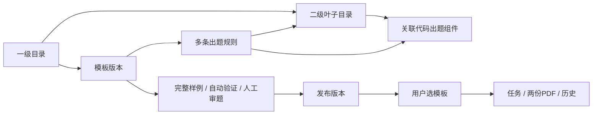

# 产品与系统设计

更新：2026-11-05。核心流程已实施，具体数据结构与接口以02、03为准；本文的扩展建议未全部实现，实际边界见[联调记录](../../implementation/两级目录与多规则后端联调.md)。

## 1. 页面与领域关系



一级目录仅组织内容，二级目录直接关联多个组件，没有第三级、独立知识点或达成目标对象。名称不限于年级和教材；不设置年级/学期/分类字段。不宣称已经同步某个教材版本。

模板包含名称、说明、标签、一级目录、每行题数和多条规则。规则包含二级目录、组件版本、题型、呈现形式、难度、题数、经schema校验的参数。竖式计算是answer题型+vertical呈现；选择/填空/解答属于题型，不重复计数。同一二级目录允许多种组件和难度。

用户以历史为首页。新增练习直接选模板，按名称和自由标签筛选；确认页展示练习内容、题型、难度、题数和总数，不开放逐规则修改，避免用户配置偏离已审核版本。二级目录名称在用户页可以用“练习内容”列表示，不要求用户理解管理树。

## 2. 服务结构

保留FastAPI、同步SQLAlchemy、Alembic、SQLite WAL；一个API进程，一个worker进程。API负责身份、内容管理、任务准入和查询；worker执行管理员样例、自动验证、用户整卷、文件修复任务。CPU数学计算和Chromium渲染在受控子进程中执行，不占用API请求线程，不在长写事务中进行。

后端模块：directory、generators、templates、releases、jobs、papers/assets、identity、operations/audit。共用短事务、统一DTO/错误码、Asia/Shanghai时间、不可变内容schema。打印页与前端共享结构化题目渲染器。

## 3. 代码出题组件契约（待实施）

组件按`key + version + artifact_hash`唯一标识，部署时注册，只能调整显示名称和启停，禁止在线上传脚本。能力矩阵按“题型+呈现形式+难度”组合声明，不能把三个独立集合的笛卡尔积误当作能力。

```text
manifest() -> key, version, artifact_hash, parameter_schema, capabilities
validate_config(rule_config) -> normalized_config | field_errors
capacity(config) -> exact_count | bounded_capacity_with_proof
generate(config, seed, count, excluded_signatures) -> Question[]
verify(question, config) -> VerificationResult
semantic_signature(question) -> canonical_signature
```

组件不读取ORM、网络、时钟或全局随机源。相同组件指纹、规范化参数和seed产生相同结果。重试沿用固定seed，不悄悄换题。管理员可自由把实际组件关联到任意二级目录，但不能配置未支持题型或难度。

整数乘法可复用现有算法；含零因数作为独立能力标识但可复用乘法内核；大数读写需开发并测试真实算法，当前高保真有条目不代表worker已支持。发布必须检查worker实际安装的组件和打印资源指纹。

统一Question输出包含schema_version、id、rule_id、leaf_name_snapshot、question_type、render_mode、difficulty、stem_blocks、options、answer、explanation_steps、render_spec、layout、semantic_signature。不再要求knowledge_revision或objective_revision。新增类型需要明确schema、验证器、共享渲染器和PDF测试，不允许任意HTML。

## 4. 整卷分配与去重

按规则排序逐条生成指定题数；校验每条实际数量与配置相等，整卷数量为总和。全卷共享语义签名集合，不按组件ID隔离去重，防止两个组件产出同一道题。乘法签名需包含题型、任务语义和规范化数值，不把仅题号变化当作新题。

容量校验既检查单条容量，也检查多条规则重叠空间：不能仅将单规则容量相加。支持可枚举组件时计算候选并分配；不能给出重叠组合可用证明时拒绝发布并返回具体规则，不用无限随机重试伪造容量。运行仍设置有限采样上限，耗尽失败，不少出题、不偷偷调整难度。

## 5. 删除与编辑建议

目录改名不改变ID；现有已发布模板保存目录名称快照，后台提示需新版本才能同步名称。一级/二级目录停用或软删除、解除组件关联、组件停用均立即影响新任务准入和在途最终提交。恢复启用不补造被取消的任务。

二级目录不允许移动到另一个一级目录（一期避免已发布规则引用变义）；可在目标一级目录新建并调整模板。引用中的目录删除返回影响模板列表，先停用或替换引用。数据删除不级联删除历史、验证报告、试卷或文件。

## 6. 实施顺序与验收

1. 审阅本设计，确定整卷上限、版本切换、重建方案。
2. 新数据库基线、v2 DTO/错误码及生成组件输出schema，冻结后再联调。
3. 两级目录与组件API；接管理台树和关联页面。
4. 多规则模板版本、整卷生成/去重、真实样例与审题发布。
5. 公开模板接口和按模板任务受理，替换iframe数据桥及用户端本地模拟生成。
6. worker整卷、共享打印页、两份PDF、历史/冷却/恢复。
7. 真实浏览器从新建目录到发布、用户生成、下载、重开历史；故障和备份恢复验收。

后端改造不得把当前前端本地保存当作服务端完成。旧代码路由及数据库在审阅阶段保持现状。
